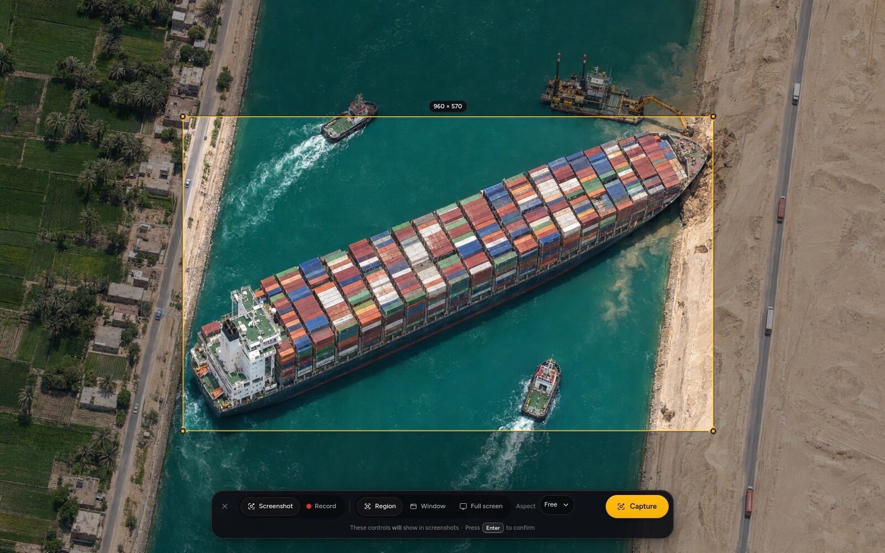
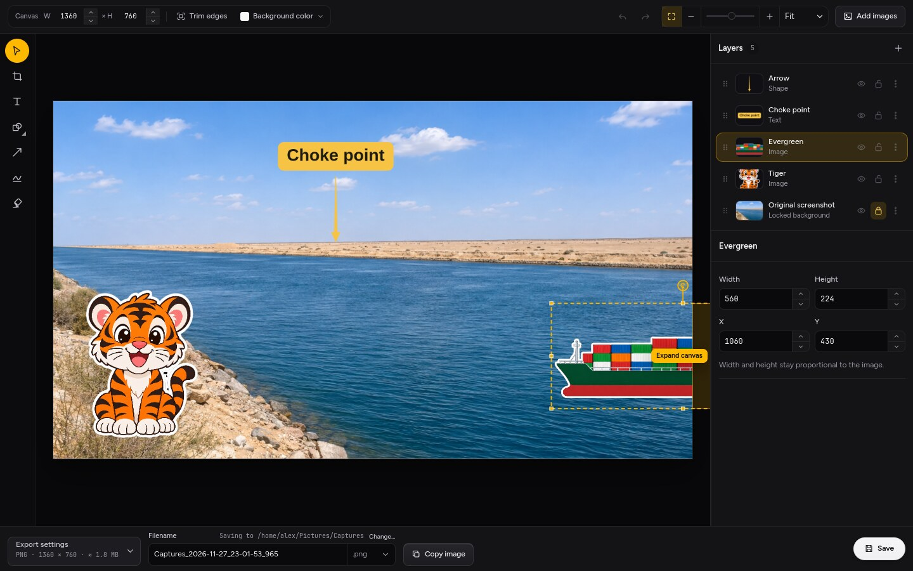
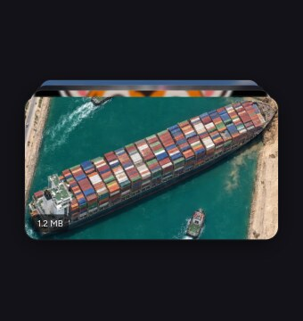
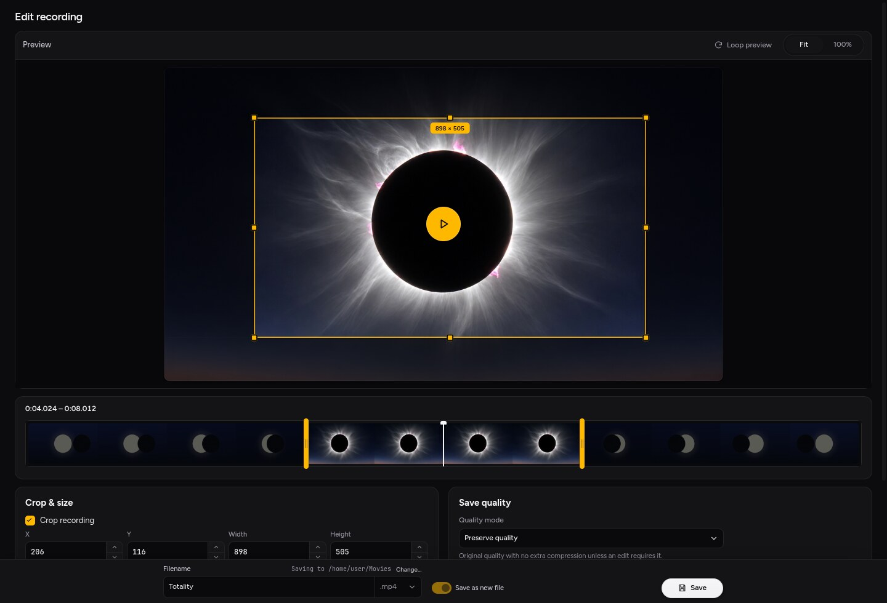
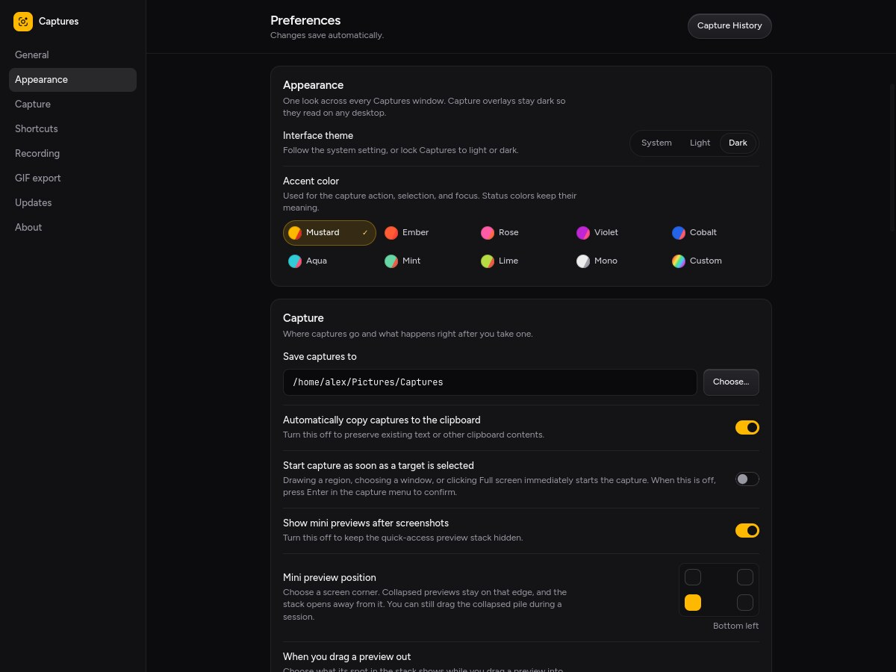

# Captures

A cross-platform screen capture utility for macOS, Windows, and Linux.

**[captur.es](https://captur.es)**

> [!NOTE]
> Captures is under active development. See [Platform status](#platform-status) below for current OS support and known limitations.

## A quick look

<table>
  <tr>
    <td width="50%">
      
       
      <strong>Capture what you need</strong> · A region, a window, or a full display. Screenshot or record from the same menu.
    </td>
    <td width="50%">
      
       
      <strong>Edit right away</strong> · Annotate screenshots with text, arrows, shapes, and crops.
    </td>
  </tr>
  <tr>
    <td width="50%">
      
       
      <strong>Keep captures handy</strong> · Collapse recent captures into a compact corner stack until you need them.
    </td>
    <td width="50%">
      
       
      <strong>Trim and export</strong> · Preview, trim, crop, and export MP4 or GIF with quality and audio controls.
    </td>
  </tr>
  <tr>
    <td colspan="2">
      
       
      <strong>Make it yours</strong> · Light or dark appearance, accent colors, shortcuts, and capture defaults.
    </td>
  </tr>
</table>

## Download

Native apps for macOS (AppKit), Windows (Win32), and Linux (GTK4):

| Platform | Download |
| --- | --- |
| macOS 13+ (Apple silicon) | [Captures-macOS-Apple-Silicon.dmg](https://github.com/joswayski/captures/releases/download/preview/Captures-macOS-Apple-Silicon.dmg) |
| Windows 11 (x64) | [Captures-Windows-x64-setup.exe](https://github.com/joswayski/captures/releases/download/preview/Captures-Windows-x64-setup.exe) |
| Ubuntu / Debian (x64) | [Captures-Linux-x64.deb](https://github.com/joswayski/captures/releases/download/preview/Captures-Linux-x64.deb) |
| Other Linux (x64 AppImage) | [Captures-Linux-x64.AppImage](https://github.com/joswayski/captures/releases/download/preview/Captures-Linux-x64.AppImage) |

- **Automatic updates:** Installed apps check for signed updates on launch and every few minutes, or manually from Preferences and the menu bar / tray. If Captures will not open or cannot install an update, reinstall using the links above. Older dated releases live in the [release archive](https://github.com/joswayski/captures/releases).
- **Windows:** The installer is not Authenticode-signed yet, so SmartScreen may warn on first install.
- **AppImage:** Replace your existing copy (normally `~/.local/bin/Captures.AppImage`) and mark it executable (`chmod +x`).
- **Release notes:** Highlights are generated during the release build from source changes only; the desktop app never sends captures or app data to generate them.
- **Upgrading from older builds:** Earlier installs update automatically and import existing settings read-only. See [docs/releases.md](docs/releases.md) for backup and recovery details.

## Features

- **Flexible capture:** Regions (with aspect-ratio presets or `Shift` for a square), windows, or full displays. Screenshot or record from the same menu, with optional countdowns and auto-start.
- **Freeze screen:** Freeze the desktop while choosing a region or window so hover states, tooltips, and menus stay put (toggleable in Preferences), with optional cursor capture preserving the active system cursor shape.
- **Screen recording & GIFs:** Record H.264 MP4 with desktop audio and microphone, pause/resume/restart/mute mid-recording, take screenshots while recording, keep the capture region highlighted, and export as MP4 or GIF (WebM export is not supported).
- **Built-in screenshot editor:** Annotate with bold or regular text labels, arrows, shapes, freehand drawings, drop shadows, rotation, crop, canvas expansion, eraser, clipboard image paste (`Cmd`/`Ctrl`+`V`), and PNG/JPEG/WebP export with live before/after compression previews. Unsaved edits restore if you reopen.
- **Built-in recording editor:** Trim, crop, resize, adjust audio, estimate output file size, and compare compression quality before saving.
- **Open existing files:** Open PNG, JPEG, WebP, GIF, MP4, and WebM files directly with Captures from Finder, File Explorer, or your file manager.
- **Mini previews & 30-day history:** Copy, save, or drag recent captures straight into other apps, collapse previews into a movable corner stack, and browse or drag directly from 30-day history filtered by screenshots, video, or GIF.
- **Customizable & private:** Light, dark, or system appearance, accent colors, customizable shortcuts, searchable Preferences (`Cmd`/`Ctrl`+`F`), optional launch on login, and optional in-app feedback (never includes your captures). After an unexpected quit, Captures may send a redacted crash diagnostic (app version, OS, and crash summary; never captures or home-directory paths).

## Optional cloud accounts (in development)

Screenshots, GIFs, and recordings work completely offline and never require an account. Accounts, hosted uploads, and link sharing are not available yet.

## Wishlist

- Scrolling capture for content larger than the screen
- On-device text recognition (OCR)
- Repeat the previous capture area
- Pinned captures that stay above other windows
- Editable click highlights and keystroke overlays after recording
- Hosted sharing with `captur.es/<id>` links
- Faster recording on Windows and Linux

## Platform status

| Platform | Status |
| --- | --- |
| macOS 13+ | Supported (primary development target) |
| Windows 11 | Supported (active native parity work) |
| Linux X11 | Supported (hide recording controls manually during recording; physical-hardware verification pending) |
| Linux Wayland | Partial support (no window targeting, cursor capture, or click highlights; mini-preview stack cannot poll the pointer and may cover apps underneath) |

## Shortcuts

Defaults match each platform’s built-in screenshot keys. `Esc` cancels an active capture or countdown and returns to other apps as soon as the capture flow closes. Global shortcuts can be changed in Preferences.

### macOS

| Default shortcut | Action |
| --- | --- |
| `Cmd`+`Shift`+`Space` | Open New Capture |
| `Cmd`+`Shift`+`4` | Capture a region |
| `Cmd`+`Shift`+`W` | Capture a window |
| `Cmd`+`Shift`+`3` | Choose a display for a full-screen screenshot |
| `Cmd`+`Shift`+`5` | Record a region |
| `Cmd`+`Shift`+`Option`+`W` | Record a window |
| `Cmd`+`Shift`+`Option`+`3` | Choose a display to record full screen |
| `Esc` | Cancel an active capture or countdown |

### Windows

| Default shortcut | Action |
| --- | --- |
| `Ctrl`+`Shift`+`Space` | Open New Capture |
| `Win`+`Shift`+`S` | Capture a region |
| `Alt`+`PrtScn` | Capture a window |
| `PrtScn` | Choose a display for a full-screen screenshot |
| `Win`+`Alt`+`R` | Record a region |
| `Ctrl`+`Shift`+`Alt`+`W` | Record a window |
| `Ctrl`+`Shift`+`Alt`+`3` | Choose a display to record full screen |
| `Esc` | Cancel an active capture or countdown |

### Linux (GNOME / Ubuntu)

| Default shortcut | Action |
| --- | --- |
| `PrtScn` | Open New Capture |
| `Super`+`Shift`+`S` | Capture a region |
| `Alt`+`PrtScn` | Capture a window |
| `Shift`+`PrtScn` | Choose a display for a full-screen screenshot |
| `Ctrl`+`Shift`+`Alt`+`R` | Record a region |
| `Ctrl`+`Shift`+`Alt`+`W` | Record a window |
| `Ctrl`+`Shift`+`Alt`+`3` | Choose a display to record full screen |
| `Esc` | Cancel an active capture or countdown |

**System shortcuts & editor keys:** Captures clears overlapping system screenshot shortcuts on macOS, GNOME, KDE, and Windows when configured to use them. While an overlay is open, capture shortcuts switch modes in place, or press the same shortcut again to capture the overlay itself. In the screenshot editor: `Cmd`/`Ctrl`+`S` saves, `Cmd`/`Ctrl`+`Shift`+`C` copies, `Cmd`/`Ctrl`+`D` duplicates layers, `Cmd`/`Ctrl`+`V` pastes images, and `Enter` applies a crop. In the recording editor: `Space` plays/pauses, `Left`/`Right` steps frames (`Shift` for 1 second), `I`/`O` sets trim in/out, `Home`/`End` jumps to trim bounds, and `Cmd`/`Ctrl`+`S` saves.

## Development

See [DEVELOPMENT.md](DEVELOPMENT.md) for local setup, validation, and packaging, [docs/releases.md](docs/releases.md) for release and updater operations, and [docs/native-rewrite.md](docs/native-rewrite.md) for native host architecture and parity tracking.

## License and trademarks

The source code is licensed under the [Apache License 2.0](LICENSE).

The Captures name and logo are governed by the [Captures Trademark Policy](TRADEMARKS.md) and are not licensed under the Apache License 2.0.
